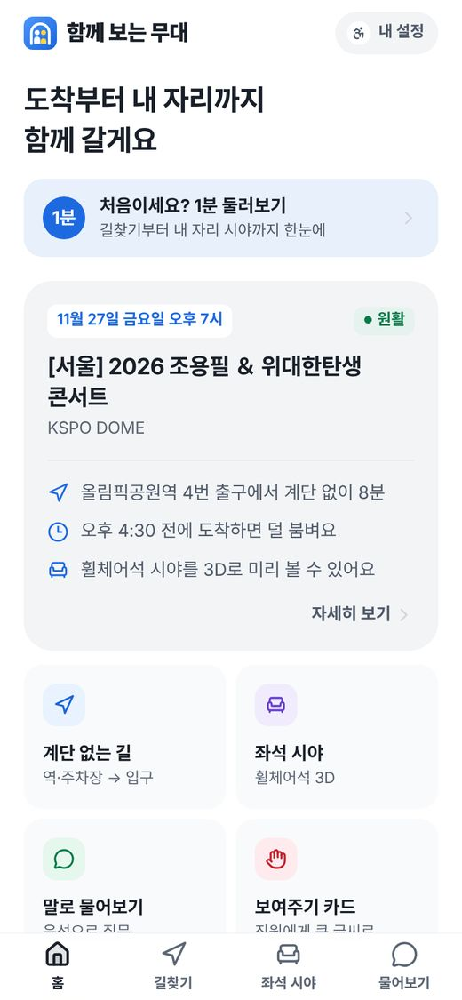
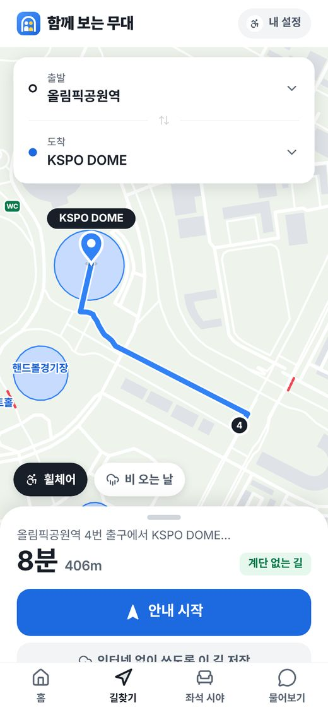
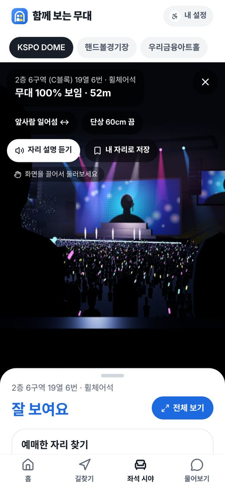
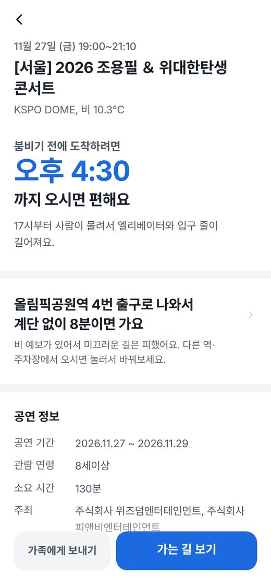
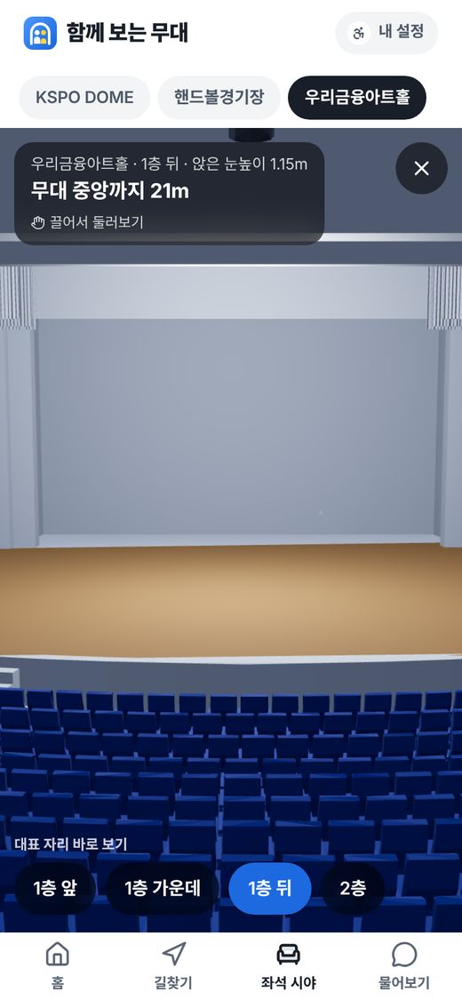
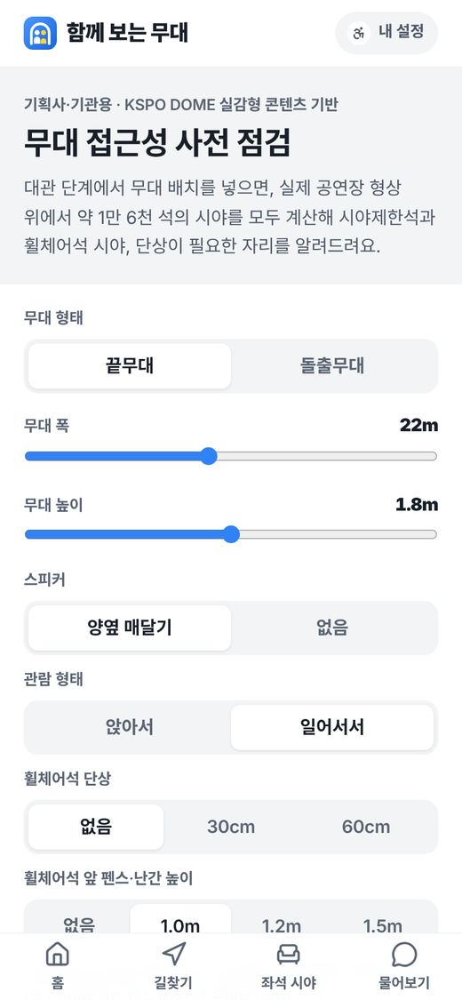
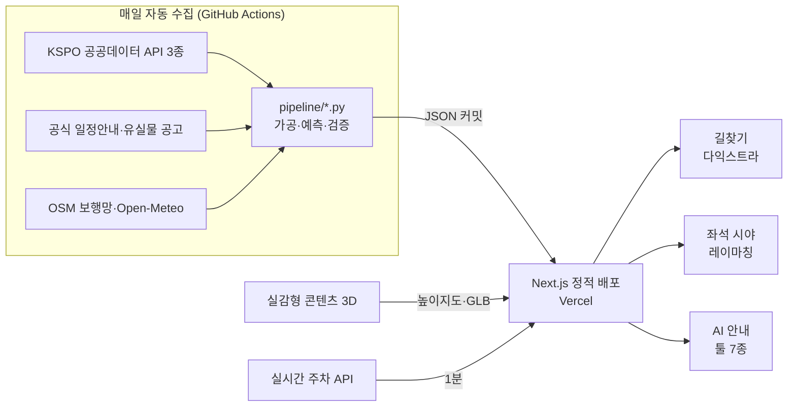

<div align="center">


# 함께 보는 무대

**휠체어 이용자 · 계단이 힘든 사람 · 저시력 · 청각장애 · 고령 관객이<br/>올림픽공원 공연을 도착부터 내 자리까지 걱정 없이 보도록 돕는 모바일 웹 서비스**

[서비스 바로 쓰기](https://together-stage.vercel.app) · [60초 시연 영상](docs/demo.mp4) · [예측은 이렇게 검증했어요](https://together-stage.vercel.app/data) · [가공 데이터 내려받기](https://together-stage.vercel.app/open-data)

[](https://github.com/BBZJUN/together-stage/actions/workflows/verify.yml)
[](https://github.com/BBZJUN/together-stage/actions/workflows/a11y.yml)
[](https://github.com/BBZJUN/together-stage/actions/workflows/events.yml)

2026년도 한국체육산업개발(주) 공공데이터 활용 경진대회 · 활용사례 출품작

</div>

<table>
<tr>
<td align="center"><br/><sub>내 도움 유형에 맞춘 홈</sub></td>
<td align="center"><br/><sub>계단 없는 길찾기</sub></td>
<td align="center"><br/><sub>내 자리 1인칭 시야</sub></td>
<td align="center"><br/><sub>붐비기 전 도착 시각</sub></td>
</tr>
<tr>
<td align="center"><br/><sub>청각장애 관객용 보여주기 카드</sub></td>
<td align="center"><br/><sub>다른 공연장 객석 시점</sub></td>
<td align="center"><br/><sub>기관용 무대 접근성 점검</sub></td>
<td></td>
</tr>
</table>

## 왜 만들었나

공연장 안내는 대부분 "○번 출구 도보 10분"에서 끝납니다. 휠체어 이용자와 고령 관객에게 필요한 건 다른 질문입니다.

| 질문 | 근거 |
|---|---|
| 그 길에 **계단**이 있나? 비 오는 날 미끄럽지 않나? | 장애예술인이 꼽은 관람의 가장 큰 어려움은 이동 ([경북매일 2026.9](https://www.kbmaeil.com/article/20260926500044)) |
| 휠체어석에서 **무대가 보이나?** 앞사람이 일어서면? | KSPO DOME 휠체어석 앞 펜스·표지판이 시야를 가리고, 관객이 일어서면 보기 어려움. 관객 인터뷰 "복불복이에요" ([비마이너](https://www.beminor.com/news/articleView.html?idxno=30041)) |
| 미리 알 수 있나? | 올림픽공원 공연에서 시야 제한을 공연 1~2주 전에야 안내받은 사례 ([한국일보](https://v.daum.net/v/EshrORuGGj)) |
| 언제 가야 덜 붐비나? | 2024.7 입출차 21.5만 건 분석: 행사일 동시 주차 최대 2,202대 — 평소 하루 최대치(중앙값 966대)의 2배 이상 |

서울 장애인의 64.5%는 최근 1년간 오프라인 공연·전시를 한 번도 관람하지 못했습니다 (일반시민 23.9%, [서울문화재단 2024 실태조사](https://www.hankyung.com/article/2025071351081)).

## 무엇을 하나

| 기능 | 하는 일 |
|---|---|
| **도움 유형 맞춤** | 휠체어 · 계단이 힘듦 · 저시력 · 청각 · 어르신 동반 중 복수 선택. 저시력·어르신은 큰 글씨 화면 |
| **계단 없는 길찾기** | 역 출구·주차장 → 공연장 입구. 휠체어는 계단 구간 제외, 비 오는 날은 자갈·나무데크 회피, 조건에 맞는 출구 자동 추천. 큰 글씨·음성 단계 안내 |
| **내 자리 1인칭 시야** | 티켓의 층·구역·열·번호를 넣으면 KSPO DOME 실측 3D 위에서 공연 당일 장면으로 그 자리 시야를 보여줌. 앞사람 일어섬·휠체어석 단상 즉시 비교 |
| **다른 공연장 둘러보기** | 핸드볼경기장·우리금융아트홀 3D. 좌석·무대를 색으로 구분하고, 대표 자리 버튼으로 바로 객석 시점 |
| **붐비지 않는 도착·퇴장** | 공식 일정의 실제 공연마다 혼잡 예측 → "오후 4:30까지 오시면 편해요". 크게 붐빌 수 있는 날은 30분 앞당겨 안내 |
| **보여주기 카드** | 청각장애 관객이 직원에게 보여주는 큰 글씨 문장. 내 자리·공연 자동 입력, 상대 쪽으로 뒤집기, 답 쓰기 칸 |
| **자리 음성 설명** | 시각장애 관객을 위해 방향·거리·보임 %·난간·통로까지 좌석 수를 글과 소리로 |
| **오프라인 길안내** | 공연날 통신이 끊겨도 저장해 둔 길과 카드로 안내 (PWA) |
| **말로 물어보기** | 길·화장실·시야·분실물·주차를 데이터에서 조회해 답하는 AI. 데이터에 없는 시설 정보는 단정하지 않음 |
| **기관·기획사용** | [무대 접근성 사전 점검](https://together-stage.vercel.app/check)(16,127석 시야로 시야제한석·휠체어석 단상 권고, CSV·PDF), [기관 리포트](https://together-stage.vercel.app/insight), [가공 데이터 재공개](https://together-stage.vercel.app/open-data) |

## 데이터 — 왜 썼고, 어떻게 가공했고, 어떻게 확인했나

### 한국체육산업개발(주) 데이터 9종

| 데이터 | 왜 필요했나 | 어떻게 가공했나 | 어떻게 확인했나 |
|---|---|---|---|
| **공연장 실감형 콘텐츠 – KSPO DOME** (DAE 475MB, 삼각형 263만) | 휠체어석에서 무대가 보이는지는 실제 형상이 있어야 계산 가능 | 단위·축 변환 → 0.5m 높이지도 + 웹용 GLB 1.7MB. 높이지도에서 계단식 객석을 읽어 16,127석 배치 | 좌석 수·휠체어석 22석·시야 규칙(앞사람이 서면 줄고 단상을 올리면 늚)을 테스트로 매번 확인 |
| **실감형 콘텐츠 – 핸드볼경기장·우리금융아트홀** (GLB 77MB·166MB) | KSPO DOME 밖 공연장도 객석 시점이 필요 | UV·텍스처 제거, 정점 병합·단순화, meshopt 압축 → 0.9MB·1.4MB. 면 방향·크기로 좌석/계단/무대 구분 | 대표 자리 8곳에서 바닥 높이 자동 탐색, 화면 캡처로 시점 확인 |
| **차량입출차·공연·날씨 연계** (API, 2025년 7,803시간) | 공연 규모·날씨에 따라 언제 붐비는지 학습할 유일한 자료 | 설명 문자열 분해 → 시간대·요일·기온·공연 규모·공연까지 남은 시간 특성. 11~12월 결측·인위적 값 제외(7,265시간 사용) | 주 단위 5-겹 교차검증(아래 표) |
| **입출차 정보 2024.7** (파일, 215,528건) | 실제 동시 주차량·출차 속도 | 10분 단위 동시 주차·출차량 계산, 행사일 자동 탐지 | 행사일(7/20·21) 최대 2,202대 = 평소 하루 최대치 중앙값(966대)의 2배 이상 |
| **입출차정보 전체구역 2025** (API, 약 240만 건) | 어느 게이트로 차가 몰리는지 | 입·출구 게이트 분해 | 매일 자동 수집 |
| **공연정보** (API, 2,502건) | 공연장별 시작 시각 패턴 | 공연장 표기 10가지 정리 | 날짜 필드가 없어 2,257건(90%)은 공연일을 알 수 없음을 발견 → 개선 제안 |
| **올림픽공원 공식 일정안내** (홈페이지, 공연 38건) | 공연정보 API에 날짜가 없어 실제 일정이 필요 | "토 오후 6시 / 일 오후 5시" 같은 자유 서술을 회차별 날짜·시각으로 변환 | 실제 문장 13건을 사람이 읽은 값과 비교하는 테스트 → "주말 및 공휴일" 공연이 매일로 잡히던 버그를 찾아 수정 |
| **유실물센터 습득 공고** (홈페이지, 첨부 HWP) | 공연 뒤 분실물 문의 | 첨부 한글 파일의 표를 물품 단위(접수일·품명·장소)로 구조화 | 물품마다 원문 링크 보존, 테스트로 형식 확인 |
| **실시간 주차현황** (API, `parking_sum`) | 지금 주차장 상황 | 1분 단위 조회, 점검 응답 처리 | 못 불러오면 숫자를 지어내지 않고 "불러오지 못했어요"라고 답하는지 테스트 |

### 민간·타기관 데이터

| 데이터 | 왜 | 가공 | 확인 |
|---|---|---|---|
| **OpenStreetMap 보행 네트워크** (ODbL) | 계단·바닥재·지하철 출구가 표시된 유일한 공개 보행망 | 길찾기 그래프(노드 4,020 · 구간 4,530)에 계단·고르지 않은 바닥·차도·지붕 표시 | 출발지 21곳 × 공연장 4곳 = 84개 휠체어 경로 모두 계단 0곳 |
| **Open-Meteo 날씨 예보** | 비 오는 날 경로·혼잡 예측 | 공연일 기온·강수 | 예보가 없는 먼 날은 평년값을 쓰고 화면에 "평년 기온"으로 표시 |

## 검증

모든 사실·숫자·인용을 원본과 대조한 결과는 **[근거 검증 보고서](docs/VERIFICATION.md)** 에 있습니다(확인·수정·가정 구분). 코드나 데이터가 바뀔 때마다 GitHub Actions가 아래를 다시 확인합니다. 기획서에 적은 수치는 테스트가 코드에서 직접 다시 계산해 맞는지 봅니다.

| 영역 | 무엇을 확인하나 | 결과 |
|---|---|---|
| 길찾기 | 휠체어 84개 경로 계단·휠체어 불가 구간 0, 비 오는 날 미끄러운 바닥이 늘지 않음, 이용 불가 출구 추천 안 함 | ✅ |
| 좌석 시야 | 16,127석, 휠체어석 22석(C블록), 앉음 100% → 일어섬 85% → 단상 30cm 100%, 펜스 1.2m 23%, 사람 치수가 국가 인체치수조사 값인지 | ✅ |
| 공개 데이터 | 좌석별 시야 CSV가 현재 엔진 결과와 같은지 (낡은 파일 방지) | ✅ |
| 혼잡 예측 | R² 0.805, 평균 오차 399 → 182대(55%↓), 공연일 혼잡 단계 90% 일치 | ✅ |
| 사람 치수·속도 | 시야 계산의 사람 치수가 국가 인체치수조사 값, 걷는 속도가 경찰청 보행 기준(일반 1.0·교통약자 0.7m/s)인지 | ✅ |
| 공연 시간 파서 | 공식 일정안내 실제 문장 13건 + 규칙 | ✅ |
| AI 안내 | 엘리베이터·경사로·셔틀 등 데이터에 없는 시설은 단정하지 않고 문의처 안내 | ✅ |
| 접근성 | 주요 10개 화면 WCAG 2.1 AA 자동 점검(axe-core) 위반 0건 | ✅ |

**혼잡 예측 상세** (2025 연계 데이터, 같은 주는 학습·검증에 함께 넣지 않는 주 단위 5-겹 교차검증)

| 지표 | 요일·시간 평균 | 예측 모델 |
|---|---|---|
| 평균 오차 (전체 7,265시간) | 399대 | **182대** |
| 설명력 R² (전체) | 0.522 | **0.805** |
| 설명력 R² (공연일) | 0.502 | **0.734** |
| 실제로 크게 붐빈 날(11일) 미리 경고 | — | 평균 예측 5일 → **위쪽 범위(90% 분위수) 8일** |

> 한계: 주차장이 75% 넘게 찬 시간은 1년에 34시간뿐이라 시간 단위로는 놓치는 경우가 많습니다. 그래서 위쪽 범위 예측을 함께 계산해 "붐빌 수 있는 날"은 도착 시각을 30분 앞당겨 안내합니다(304일 중 26일 경고).

```bash
npm test            # 길찾기·시야·데이터·AI (vitest)
npm run test:py     # 공연 시간 파서 (python)
npm run typecheck && npm run lint
npm run a11y        # 접근성 (서버 실행 후)
```

## 구조



```
pipeline/
  fetch_api.py · fetch_events.py · fetch_lost.py   수집
  showtime.py                                      공연 시간 자유 서술 → 회차
  train_model.py                                   혼잡 예측 학습·교차검증 → model_report.json
  build_forecast.py                                회차별 예측 → src/data/shows.json
  build_graph.py                                   OSM → 길찾기 그래프
  tests/                                           파서 테스트
src/lib/
  route.ts      도움 유형·날씨별 비용으로 길찾기
  venue.ts      실측 높이지도 기반 좌석 생성·시야 계산·자리 설명
  assess.ts     무대 접근성 사전 점검
  agent.ts      AI 안내 툴 + 규칙 기반 응답
tests/          길찾기·시야·데이터·AI 테스트
```

## 실행

```bash
npm install
cp .env.example .env.local   # AI 키 (없어도 규칙 기반으로 동작)
npm run dev
```

## 운영 (2028년까지)

- 정적 배포 + 하루 1회 배치라 서버·DB·지도 타일 비용이 없습니다. 지도는 OSM 데이터로 직접 그립니다.
- AI는 Gemini 무료 등급 + 캐시, 한도 초과·장애 시 규칙 기반으로 자동 전환 → 운영비 0원에서도 모든 기능 동작
- 데이터 수집 작업은 서로 겹치지 않게 순서대로 돌고, 연계 데이터가 바뀌면 모델을 다시 학습·검증합니다.

## 한계와 다음 단계

- 휠체어석은 공식 좌석배치도의 'C블록 뒤편' 구역까지 확인했고, 열·번호와 앞 펜스 높이(기본 1.0m), 좌석 높이 0.40m, 공연 관람객 수(매진 가정)는 가정입니다. 기관 상세 배치도·현장 실측으로 보정합니다.
- 계단·엘리베이터 정보는 OSM에 표시된 곳 기준입니다. 확인되지 않은 정보는 화면과 AI 답변에 "미확인"으로 표시합니다.
- 핸드볼경기장·우리금융아트홀은 좌석 배치 데이터가 없어 좌석별 보임 %는 KSPO DOME에서만 제공합니다.

## 출처

- 한국체육산업개발(주) 공공데이터 ([공공데이터포털](https://www.data.go.kr), [올림픽공원](https://www.ksponco.or.kr))
- 지도 데이터 © [OpenStreetMap](https://www.openstreetmap.org/copyright) contributors, ODbL · 날씨 [Open-Meteo](https://open-meteo.com)
- 휠체어석 위치: [올림픽공원 KSPO DOME 좌석배치도](https://www.ksponco.or.kr/olympicpark/eventInfo/eventInfoView.es?mid=a20301010100&evtSeq=4627) · 기준: [공연장안전지원센터 객석 설계 안전 가이드](https://stagesafety.or.kr/resource/venue/file/bo12.pdf)
